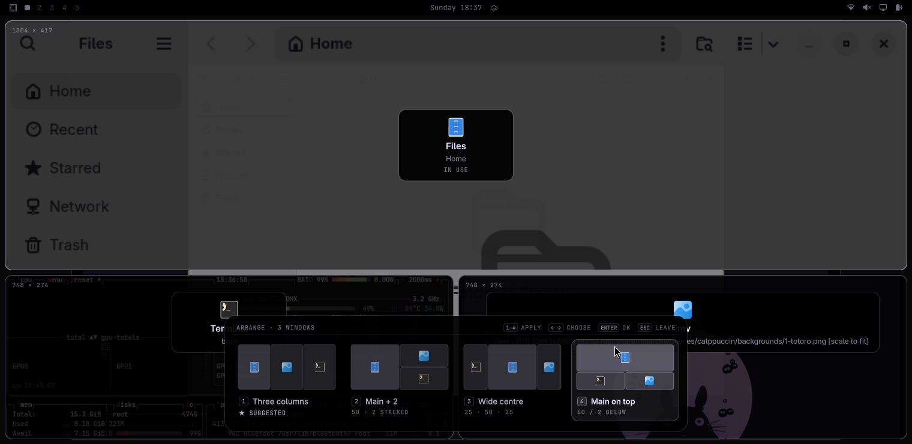

<div align="center">

# Island Arrange

**See how your windows would fit before they move.**
Super + A shows the ways to arrange a screen, previewed on the screen itself.



</div>

## Why this one

- 👀 **A preview on the screen itself.** The windows glide to where the highlighted
  model would put them, with a frame of each one, its app and its size.
- 🧮 **Models worked out for the moment.** Only the ones that leave every window usable
  room on this screen: a big monitor gets more columns than a laptop.
- ⭐ **A suggestion that learns.** The window in use takes the main spot, wide apps the
  wide spots, and the suggestion leans on what you pick most for that screen.
- ✋ **Leave a window out.** Right click one and it stays where it is, while the models
  are worked out again for the others.
- ↩️ **Undo.** `0` puts the windows back as they were, while nothing has moved since.
- ⌨️ `1`–`9` apply a model, `←` `→` choose, `Enter` or Super + A again confirm, `Esc` leaves.
- 🌍 English and Portuguese, following your system language.

It arranges once, when you pick. Nothing moves afterwards.

## Requirements

[Smart Windows](https://github.com/hugorolimf/omarchy-smart-windows) 2.0 or newer, which
works out the models and moves the windows. On its own, this panel does nothing.

## Install

```bash
git clone https://github.com/hugorolimf/omarchy-smart-windows
git -C omarchy-smart-windows checkout --detach 7d6a8a2c3b6bdf2835f8613c33b46bcdd4af9f25
omarchy-smart-windows/install.sh
omarchy plugin add https://github.com/hugorolimf/omarchy-island-arrange --enable
omarchy-restart-shell
```

The commit above is the Smart Windows 2.0 release this panel was tested with, so the
installer you run is exactly the one that was reviewed.

## How it talks to Smart Windows

Smart Windows writes the models to a private file,
`$XDG_RUNTIME_DIR/island-arrange/models.json`, because they carry window titles, and calls
`omarchy-shell io.github.hugorolimf.arrange showFile <that path>`. The panel accepts only
that path, and answers through `hyprctl eval`. It writes no files of its own.

## Remove

```bash
omarchy plugin remove io.github.hugorolimf.arrange
```

Super + A then applies the suggested model right away.

## License

MIT © Hugo Rolim Filho
